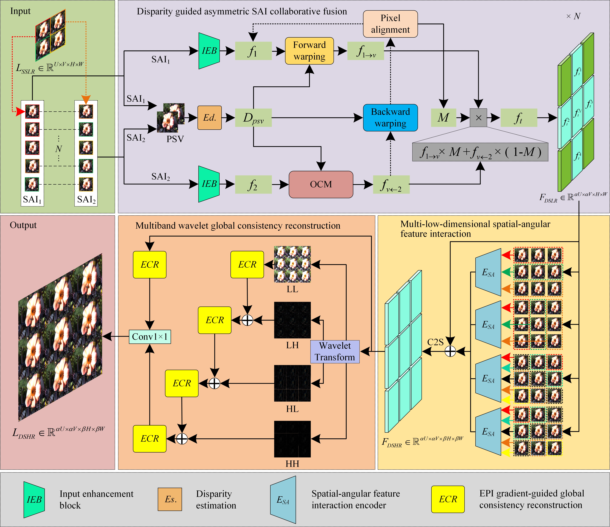
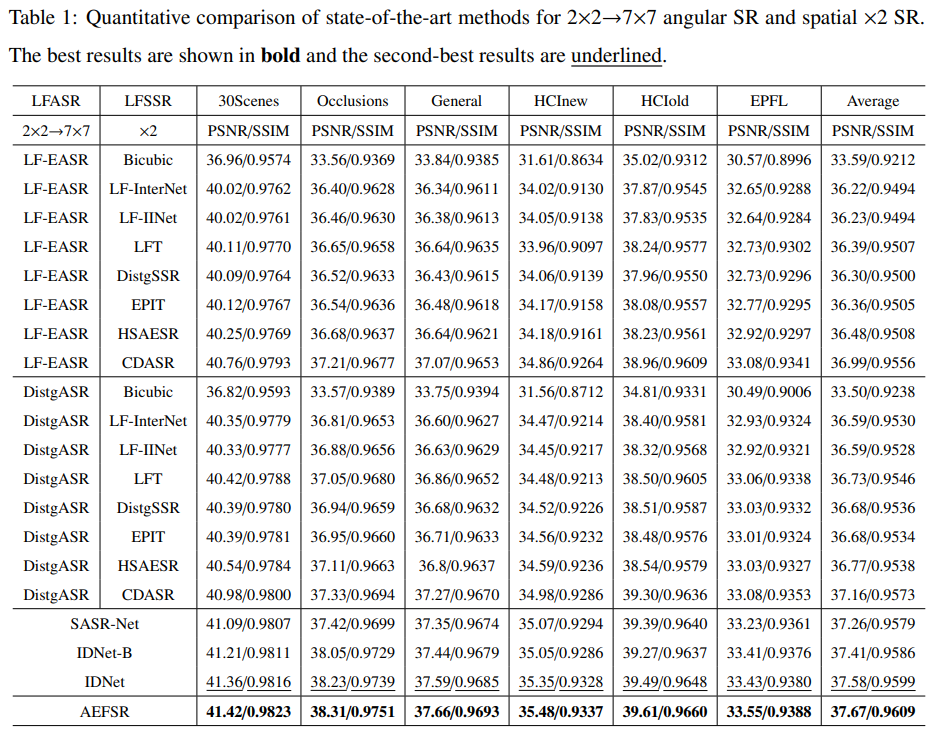
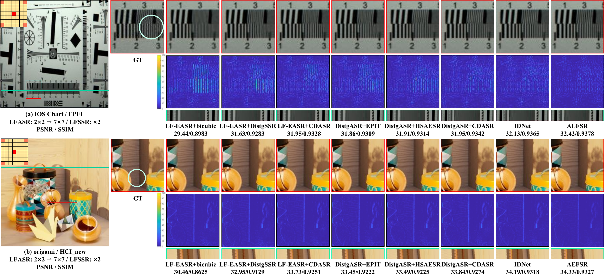
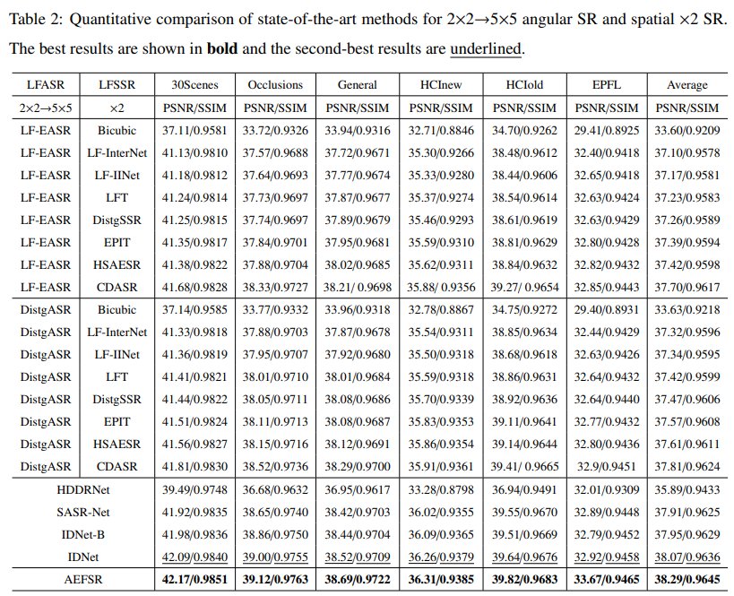
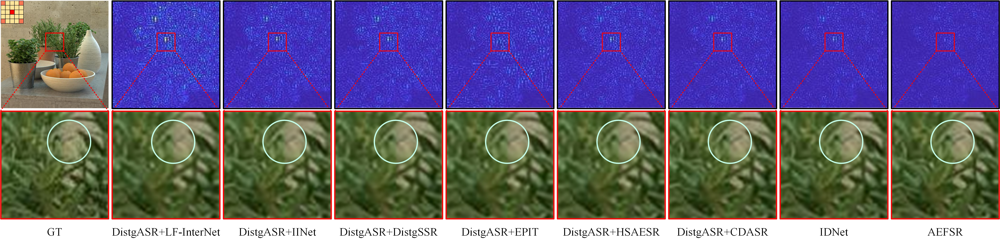
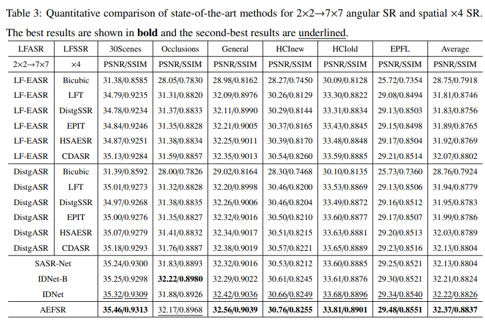

# AEFSR-PyTorch

### Abstract

Light field (LF) imaging captures 4D intensity and angular information, demonstrating significant potential in applications such as post-capture refocusing. However, the limited number of sensors in LF imaging devices makes it challenging to simultaneously achieve high spatial-angular resolution. Consequently, numerous studies have focused on LF super-resolution (SR) in spatial and angular dimensions. However, existing methods struggle to effectively integrate the two, resulting in cumulative errors. Furthermore, disparity discrepancies exist between LFs reconstructed using different angular up-sampling factors (α), resulting in domain shift. Based on this, we propose AEFSR, an optical imaging physics-constrained framework for LF spatial-angular SR. For angular SR, AEFSR introduces a disparity-guided asymmetric SAI fusion that leverages two adjacent SAIs to collaboratively generate intermediate views, utilizing a binary mask to strictly constrain occlusions. For spatial SR, AEFSR introduces a multi-low-dimensional spatial-angular interaction that constructs LF stacks from four directions and performs feature interactions in different subspaces to comprehensively model spatial details. To address domain shift, AEFSR includes a multiband-wavelet global consistency reconstruction that performs feature complementarity across frequency bands using Haar wavelet transform and leverages EPI gradient priors to guide feature-weighted fusion of aligned SAIs, enhancing the model’s adaptability to varying α. Furthermore, based on the inherent optical physics of LF, we introduce an EPI linearity constraint to drive AEFSR, ensuring that the reconstruction aligns with the imaging characteristics of real LF. Experimental results demonstrate that AEFSR reconstructs LFs with finer details and ensures angular geometric consistency, outperforming comparative methods across multiple public datasets.

### Network Architecture



PyTorch implementation based on the paper: "Asymmetric SAI collaborative fusion light-field spatial-angular super-resolution based on EPI linear constraint".

- Python 3.10
- PyTorch 2.2
- MATLAB (for training/test data generation)

Install the dependencies with:

```bash
pip install -r requirements.txt
```

### Dataset

The training datasets used in the paper include Stanford Lytro Archive (88 scenes), Kalantari (52 scenes), and HCInew (20 scenes). The test datasets include **30Scenes, Occlusions, General, HCInew, HCIold, and EPFL**.

```text
data/
├── train/
└── test/
```

### Demo

Use `test.py` to reconstruct light fields and evaluate a trained model. The main arguments are:

```text
--checkpoint         Path to the trained AEFSR checkpoint.
--data-dir           Directory containing test HDF5 files.
--output             Directory for reconstructed results and metrics.
--save-predictions   Save reconstructed light fields as HDF5 files.
--device             Device for inference, e.g., cuda or cpu.
```

### Training

An example of training a model for **2×2 → 5×5 angular SR and ×2 spatial SR** is shown below:

```bash
python train.py --train-dir data/train --angular-out 5 --spatial-scale 2 --psm-checkpoint weights/psmnet_finetuned.tar --patch 32 --batch-size 4 --epochs 100 --output runs/aefsr_5x5_x2 --device cuda
```

Set `--angular-out` to the target angular resolution and `--spatial-scale` to the spatial upsampling factor. Prepare matching data and train separate models for different resolution configurations. Reduce `--batch-size` if GPU memory is insufficient.

### Testing

An example of testing the trained model is shown below:

```bash
python test.py --checkpoint runs/aefsr_5x5_x2/best.pt --data-dir data/test --save-predictions --output runs/test_5x5_x2 --device cuda
```
### Results

#### 2×2 → 7×7 angular SR and spatial ×2 SR

Quantitative and qualitative results reported in the paper for **2×2 → 7×7 angular SR and spatial ×2 SR** are shown below.

**Quantitative comparison (PSNR/SSIM).** The best results are shown in bold, and the second-best results are underlined.



**Visual comparison on EPFL and HCInew.**



#### 2×2 → 5×5 angular SR and spatial ×2 SR

**Quantitative comparison (PSNR/SSIM).** The best results are shown in bold, and the second-best results are underlined.



**Visual comparison with error maps and enlarged local regions.**



#### 2×2 → 7×7 angular SR and spatial ×4 SR

**Quantitative comparison (PSNR/SSIM).** The best results are shown in bold, and the second-best results are underlined.



**Per-view PSNR distributions on General and Occlusions scenes.** Avg and Var denote the average and variance, respectively.


